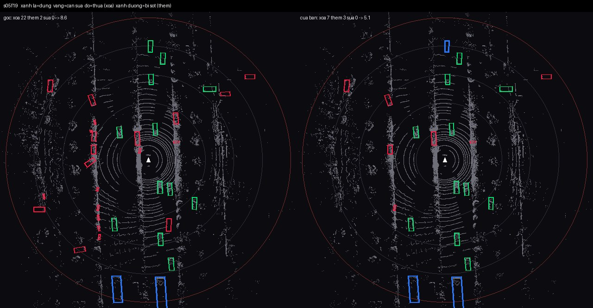

# Báo cáo Day 14 — Dương Quốc Anh — 2A202603286

- Mã học viên dùng với `--student` — `2A202603286`
- `seed_tag` trong `frames_A.txt` — `82ac3100fd`

## 1. Dự đoán trước sweep (bước 5b)

- Tham số tôi nghĩ giảm công sửa nhiều nhất là `min_points`.
- Khi rà ảnh BEV tập A, tôi thấy nhiều hộp thừa ở những vùng bị che khuất, rõ nhất ở frame thứ ba (`s05f19`). Tôi thấy một số hộp thừa chứa ít điểm LiDAR, nên dự đoán tăng `min_points` sẽ loại được các hộp như vậy và giảm số hộp cần xóa.

## 2. Tập A: sửa tay và tune

| Cấu hình | Xóa | Thêm | Sửa | Chi phí |
|---|---:|---:|---:|---:|
| Gốc (`score_thr=0.1`, `min_points=0`) | 40 | 10 | 3 | 23,5 |
| `best_config.json` (`score_thr=0.5`, `min_points=0`) | 10 | 15 | 1 | 18,5 |

- Riêng `s05f19`, cấu hình gốc cần xóa 22 hộp và thêm 2 hộp, tương ứng 8,6 điểm công sửa. Số điểm LiDAR trung vị là 59,5 ở các hộp thừa và 201,5 ở các hộp khớp nhãn tham chiếu. Trong 22 hộp thừa, có 1 hộp chứa dưới 10 điểm.
- Các mức sẽ thử gồm `score_thr` ở `0.1, 0.2, 0.3, 0.4, 0.5` và `min_points` ở `0, 5, 10`.
- `best_config.json` tăng `score_thr` từ 0,1 lên 0,5. Cả ba mức `min_points` cho cùng chi phí 18,5 ở ngưỡng điểm này. Script lưu cấu hình có `min_points=0`.
- Kết quả leave-one-out:
  - `s01f26`: `score_thr=0.5`, `min_points=0` đạt 5,9 (tốt nhất trên frame này là 5,9).
  - `s04f03`: `score_thr=0.5`, `min_points=0` đạt 7,5 (tốt nhất là 6,6).
  - `s05f19`: `score_thr=0.4`, `min_points=5` đạt 6,2 (tốt nhất là 5,1).
- Cấu hình có chi phí tổng thấp nhất trong 15 tổ hợp trên tập A. Hiệu quả thay đổi theo frame. Riêng `s04f03`, chi phí tăng từ 7,3 lên 7,5 so với cấu hình gốc.

## 3. Trước/sau (bước 8)

- `scripts/pp_compare.py` cho thấy chi phí tập A giảm từ 23,5 xuống 18,5 điểm (21,3%). Số hộp cần xóa giảm từ 40 xuống 10, số hộp cần thêm tăng từ 10 lên 15 và số hộp cần sửa giảm từ 3 xuống 1.
- Ở cấu hình gốc `score_thr=0.1`, thay riêng `min_points` từ 0 lên 5 cho chi phí 22,9. Tăng riêng `score_thr` từ 0,1 lên 0,5 cho chi phí 18,5.
- Dự đoán đúng về tác dụng của `min_points` ở mức 5: số hộp cần xóa giảm từ 40 xuống 38 và chi phí giảm 0,6 điểm. Dự đoán về tham số giảm nhiều nhất chưa đúng. Tăng riêng `score_thr` lên 0,5 giảm 5,0 điểm, dù số hộp bị sót tăng từ 10 lên 15.
- Phần diễn đạt mục 3 có hỗ trợ AI dựa trên số liệu sweep và ảnh so sánh đã lưu.

## 4. Tập B

Số đo từ `scripts/pp_prelabel.py --frames d14_2A202603286/frames_B.txt --config d14_2A202603286/best_config.json --gt d14_2A202603286/ref_B.json`:

| Xóa | Thêm | Sửa | Chi phí |
|---:|---:|---:|---:|
| 28 | 15 | 3 | 24,9 |

- Bản xuất từ CVAT có 134 hộp trên 12 frame. Script tính công sửa trên 132 hộp tham chiếu trong phạm vi 50 m.
- `Cyclist` có chi phí cao nhất theo lớp, với 16 hộp cần xóa và 5 hộp cần thêm (9,8 điểm).

## 5. Giới hạn

- Tập A chỉ có 3 frame để tune và cấu hình có chi phí thấp nhất thay đổi khi bỏ một frame.
- Trọng số KITTI học trực tiếp ba lớp `Car`, `Cyclist` và `Pedestrian`. Các lớp `Truck` và `Bus` phụ thuộc vào suy luận theo kích thước.
- Chi phí sửa là điểm tính theo số thao tác có trọng số. Bài này không đo thời gian sửa thực tế.
- Ngoài lượt pre-label của bài lab, tập B có 5 cuboid đề xuất được thêm bằng công cụ hỗ trợ. Bốn hộp dựa trên đối chiếu camera với cụm điểm LiDAR, một hộp lấy từ lượt chạy PointPillars bổ sung với `score_thr=0.2`, `min_points=5`.
